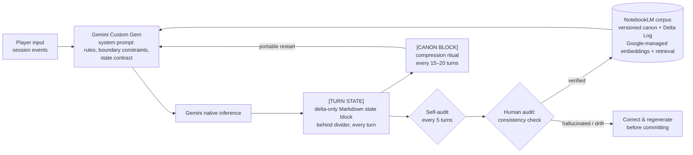
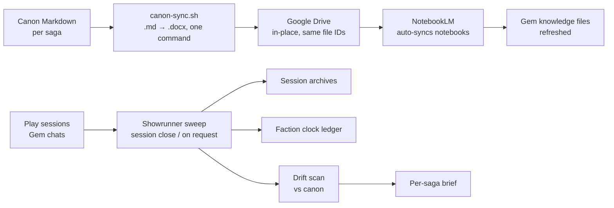

# LLM State-Tracking Lab

*Testing whether a prompt-engineered LLM can maintain coherent, structured state across long-context sessions — backed by a retrieval corpus and human-in-the-loop validation.*

## What this is

A test environment built with **Google Gemini custom Gems** and **Google NotebookLM**. Six narrative lines now run as stress tests: four original sagas (a grimdark Lovecraftian mecha RPG, "Cursed Resonance"; an original Dragon Ball saga, "Unwritten Age"; a Jujutsu Kaisen saga, "The Hollow Vow"; an original Digimon saga, "Pale Fire"), a spin-off line fed by a rumor-propagation mechanic, and a second author's saga built from their own source texts. Each demands the same thing from the model: numeric stats, narrative threads, character voice consistency, and background event clocks must stay coherent across long sessions without hallucinating.

## What this is not

- **Not a custom model or fine-tune** — the LLM is Gemini, used as-is.
- **Not a self-built RAG pipeline** — NotebookLM provides embeddings, chunking, and retrieval natively. I designed the documentation corpus and the retrieval strategy (what gets uploaded, how it's structured, how the prompt anchors to it), not the retrieval engine.
- **Not fully automated** — every state update passes through a human audit gate before being committed to the source of truth.

## Architecture

**The loop:** the Gem runs the session, emitting a mandatory structured state block at the end of every turn. Every 5 turns it re-reads its own last block and flags contradictions openly (self-audit). I audit each block against the prior log and the world bible, correct any drift, and commit the verified log to the NotebookLM corpus — which the Gem references in subsequent sessions. Every 15–20 turns the Gem distills everything into a portable canon block that can restart the session in a fresh context — designed to preserve the defined load-bearing state, and tested against a set of restart cases.

## State-tracking techniques under test

1. **Per-turn state blocks (now delta-only)** — finer granularity than session-end logs. Started as full restatement every turn; upgraded Oct 2026 to delta-only blocks: each turn reports only what *changed*, everything else referenced by tag. Same drift protection (the audit diffs deltas against the last snapshot), far less context burn. The block sits behind a divider at the end of the turn — fiction first, mechanics last.
2. **Open-loop tracking** — every unresolved narrative thread is tagged ADVANCING or PARKED in the state block. Threads can't be silently dropped; the audit checks the list.
3. **World clocks** — background/off-screen state (faction plans, rival timelines) that advances on triggers *and* between sessions, whether the player is involved or not. The hardest case for an LLM: state the player never sees to catch errors in.
4. **Self-audit turns** — every 5 turns, the model re-reads its own last state block and diffs it against what actually happened. Contradictions get an open `AUDIT FLAG` and a fix, never a silent overwrite. This sits *under* the human gate, not instead of it.
5. **Canon compression ritual** — every 15–20 turns, the full state is distilled into a self-contained `[CANON BLOCK]` (premise, entity states, threads + status, clocks, character voice tags, scene). It can be pasted into a new chat to beat context rot — the long-context countermeasure.
6. **NPC voice tags** — one line per character in every state block: how they talk + what they want. Character consistency treated as state, not vibes.
7. **Versioned canon + Delta Log** — world-changing decisions are recorded as numbered deltas against a canon version (currently v2.0 for the mecha scenario). Spinoff/sequel scenarios declare a canon anchor and inherit all deltas up to it — branching storylines without cross-contamination. The corpus is append-only history, never rewritten, so the model can't silently retcon.
8. **Cite, don't restate** — blocks reference corpus sections by tag (`[Races Codex §4]`) instead of re-explaining rules. The knowledge files carry the lore; the prompt mirrors retrieval anchors so the model cites instead of reciting. Extends the retrieval-over-prompt-stuffing decision into the output schema itself.
9. **Session hygiene** — every session opens with a "previously on" rebuilt from the last closing state block. Full logs are never pasted back in — the compression ritual is the restart path. Kills context rot at session boundaries, where long-context sessions usually die.
10. **Shadow Director guarded injections** — a meta-director layer reads session deltas across lines and generates cross-line "ripple" events, injected into target chats in a guarded format: a `[SHADOW DIRECTOR OVERRIDE]` header plus the guard line "Background only — do not advance the current scene or resolve any pending player decision." The guard exists because unguarded injections did exactly that: advanced live scenes and spent decisions the player had not made yet. A documented failure mode, a designed mitigation, and a full injection log with per-target outcomes. Protocol detail and a sample: [`living-world-pipeline/`](living-world-pipeline/) and [`sample-logs/ripple-injection-03.md`](sample-logs/ripple-injection-03.md).
11. **Sealed-knowledge architecture** — two classes of secrets, two treatments. Storyteller-held secrets live in Gem instruction text (never in knowledge files) so the storyteller can pace reveals in-story; that boundary is *behavioral guidance*, not access control, and it is backed by compensating controls: a phased reveal ladder, drift scans that audit for early or implied reveals, a reaction-proportionality check, and a human brake. A second class of sealed material never enters any Gem or corpus at all — it is held in local files only, and the pipeline tracks reveal-eligibility metadata (which phase a reveal is in), never the content.
12. **Faction dashboards (clocks as data)** — world clocks live in a single source-of-truth JSON that feeds a Google Sheets dashboard. Clock state is data with one owner, not prose scattered across archives; the pipeline updates the JSON, and every view of the world reads from it.
13. **API tandem line** — a second model API works as a production assistant (consults, first drafts, audits) behind a human QC gate. Its output is draft-only until reviewed against canon. The operational lessons from running it are documented in the case study, including the run where a target chat's stored model silently differed from the intended one: five injections failed 5/5 on the stored model and landed 5/5 after the switch.

## Components

1. **System prompts (Gemini Gems)** — role definition, mechanics rulesets, boundary constraints, and the full state contract (turn blocks, clocks, audits, compression, voice tags). Documented: [`system-prompt.md`](system-prompt.md). Four more Gems run the other sagas on the same apparatus — plus a fifth "Shadow Director" Gem that fires crossover ripple events between sagas. Six lines on one contract demonstrate breadth; they do not by themselves prove genre independence. Formal validation concentrates on one reference implementation — the Jujutsu Kaisen saga, "The Hollow Vow" — with bounded cross-saga integration tests against a designated partner line, "Cursed Resonance".
2. **Retrieval corpus (NotebookLM)** — world bibles, series bible (canon v2.0), enemy bestiary, and the Delta Log. Sample: [`docs/world-bible-resonance.md`](docs/world-bible-resonance.md)
3. **Output schemas** — `[TURN STATE]` per turn, `[SESSION LOG FOR NOTEBOOK]` per session/combat. Samples: [`sample-logs/`](sample-logs/)
4. **HITL validation pipeline** — self-audit → human audit → correct → commit. Nothing enters the corpus unaudited.

## Roadmap snapshot

The full public roadmap lives in [`ROADMAP.md`](ROADMAP.md). The sequence in brief: protect the November 17, 2026 platform migration (Item 0); validate the reference saga with a dirty-baseline test suite and a corpus quarantine; build the Proof Pack and the Session-Start State Handshake; implement the deterministic parser under the State Reconciliation Contract; then extract that same reconciliation pattern into a business demo on fictional CRM-style records, with measured results published before any portfolio claim rests on it. The living-world mechanics (Base Rule v2, LW-3, LW-4, capped LW-1, conditional LW-2) stay in the consolidated build order in the case study.

## Component status

Status key: **Implemented** = running in production play. **Proposed** = design ratified, build not started. **Planned** = sequenced in the build order (see the case study roadmap).

| Component | Status |
|---|---|
| Per-turn state contract, self-audit turns, human audit gate | Implemented |
| Canon sync (Markdown → Drive → NotebookLM → Gems) | Implemented |
| Showrunner sweep (archive, world-moves, drift scan, briefs) | Implemented — session-close / on-request triggers |
| Shadow Director guarded injections + injection log | Implemented |
| Faction dashboards (clock JSON → Sheets view) | Implemented |
| API tandem line behind the QC gate | Implemented |
| Item 0: pre-migration Skill packaging (backups by Oct 31, 2026) | Planned — build step 1 |
| Canon Test Suite — four classes, dirty-baseline run on the reference saga | Planned — build step 2 |
| File-level corpus quarantine | Planned — build step 3 |
| Portfolio Proof Pack (swimlane, redacted diff artifact, before/after scores) | Planned — build step 4 |
| Session-Start State Handshake (incl. ledger/surface beat budget) | Planned — build step 5 |
| Base faction rule v2 (evaluate always, act when justified) + LW-3 + LW-4 | Planned — build step 6 |
| LW-1 Scavenger Cascade (capped) | Planned — build step 7 |
| LW-2 Weaponized Rumor Feedback (closed design, conditions in the case study) | Planned — build step 7, last |
| State Reconciliation Contract + deterministic pre-sweep parser (first target: the reference saga) | Proposed — contract adopted Oct 23, 2026; governs the parser build |
| Business reconciliation demo (fictional CRM-style records, measured evaluation) | Proposed — approved in principle Oct 23, 2026; starts only after the parser demonstrates the contract on the reference saga |
| Epistemic typing ([FACT] / [BELIEF: holder]) + Epistemic Promotion Audit | Proposed — lands with the drift-scan/parser work |
| Fun layer (Forked Consequence engine, voice-ledger merge, cycle exploit windows, pipeline-selected callbacks, natural stopping points) | Proposed — ratified Oct 23, 2026; Gem-instruction pieces batch into Item 0's edit window |

One reusable state-management workflow, six live applications, one deeply validated reference implementation, and a bounded set of cross-saga integration tests — that is the claim this repo is organized to earn. The reference implementation is the Jujutsu Kaisen saga, "The Hollow Vow"; the integration partner is "Cursed Resonance".

## Living World Pipeline

*The lab grew a night shift.* The state contract above covers what happens *during* a session. It didn't cover what happens *between* them: faction clocks stalled, off-screen NPCs froze, and canon only moved while someone was playing. So the apparatus got a second layer — an automated showrunner loop that runs the universe around the Gems.

**Canon sync (the maintenance flow):** edit the Markdown source of truth → run `canon-sync.sh` (rebuilds every `.docx` through a Markdown converter, one command) → upload in place to each saga's Drive folder (same file IDs, so no link ever breaks) → NotebookLM auto-syncs the notebooks → the Gems read refreshed knowledge files. No manual reformatting, no drift between the source and what the model sees.

**Showrunner sweep:** a session's close triggers that saga's sweep; sweeps also run on request, and there are no silent scheduled runs. The sweep reads new play-chat messages since the last watermark → archives the session (raw log + chronicle delta + final turn state) → advances faction clocks and resolves off-screen NPC actions with real consequences → drift-scans new material against canon (contradictions flagged with a proposed fix, never silently rewritten) → writes a per-saga brief (clock positions, what's about to detonate, hooks for next session). Cross-saga ripples and handshakes are queued locally and delivered when the target saga is next opened (pull-on-play), not pushed into closed chats. If no saga had new play, the run stays silent.

**Operating rules:** read-only on play chats — the pipeline never types into or sends anything inside a session; anything outbound needs explicit per-message approval. The human alone decides canon. Seeded mysteries are never resolved, hinted at, or spent by the system. State lives in plain Markdown files (watermarks, ledgers, archives) — auditable, diffable, portable.

**Shadow Director:** the pipeline also runs a meta-director layer that turns session deltas into cross-line ripple events, delivered only in the guarded injection format (technique 10 above). Unguarded background events are a solved failure mode here, documented with its fix.

**API tandem:** a second model API assists the pipeline (consults, first drafts, audits) behind a human QC gate. Standing rules from production use: verify a target chat's *stored* configuration before any multi-target run, because session regeneration reverts to stored state; and on usage exhaustion, stop and skip the target rather than churning retries.

Full case study: [`living-world-pipeline/`](living-world-pipeline/) — the maintenance flow, the Director protocol, the tandem-line lessons, and the detailed design roadmap. The public execution roadmap, including the business reconciliation demo, is [`ROADMAP.md`](ROADMAP.md).

## Design decisions

- **Markdown as the state format:** token-efficient, human-readable, diffable, and easy to audit by eye — no tooling required to verify a commit.
- **Forced output block every turn:** guarantees a commit point. State is never allowed to persist silently in conversation memory alone.
- **Delta-only output:** full restatements were the biggest context burner in the system. Deltas against the last snapshot preserve auditability (every change is explicit) while keeping each turn's overhead proportional to what actually happened.
- **Faction clocks as hidden state:** off-screen world state that must advance on triggers (failed rolls, elapsed time) *and* between sessions — the hardest case for an LLM, since the player never sees it to catch errors.
- **Retrieval over prompt-stuffing:** long reference docs live in NotebookLM, not the system prompt, keeping the prompt lean and preserving the context window for live session state. Cite-don't-restate extends this into the output schema: blocks reference corpus sections by tag instead of reciting them.
- **Human gate before commit:** numeric state is where LLMs hallucinate most. Unverified output never becomes source of truth.
- **Append-only canon:** the corpus records history (deltas), never rewrites it. Append-only history preserves prior decisions; validation and explicit corrections govern the current projection.

## Failure modes this design anticipates

| Failure mode | Mitigation in this design |
|---|---|
| State drift over long contexts (stats silently change) | Structured block forces full state restatement every turn; self-audit diffs every 5 turns; human audit diffs against prior log |
| Context rot in very long sessions | Compression ritual: portable canon block restarts the session in fresh context, designed to preserve defined load-bearing state |
| Silent self-contradiction | Audit turns: model re-reads its own last block, open `AUDIT FLAG`s, never silent overwrites |
| Hallucinated mechanics (model invents rules) | Boundary constraint: "constantly reference uploaded Knowledge files"; audits check against world bible |
| Missed clock advancement (off-screen state stalls) | Explicit trigger rules + between-session ticks; every block must list all clocks |
| Character voice drift | NPC voice tags (speech + want) in every state block, checked at audit |
| Dropped plot threads | Open-loop list with ADVANCING/PARKED tags; audit verifies every thread is accounted for |
| Context burn from restating full state every turn | Delta-only blocks: each turn logs only changes, tagged against the last snapshot |
| Context rot at session boundaries | Session hygiene: "previously on" rebuilt from the last closing block; full logs never re-pasted |
| Cross-scenario contamination (two scenarios, one apparatus) | Canon versions are namespaced per saga; each story carries its version in every block |
| Retrieval misses (model ignores corpus) | Docs organized by mechanic; key terms mirrored in the prompt as retrieval anchors |
| Compounding errors (bad state committed, then built on) | Human review reduces the risk of bad commits; deltas make history inspectable; planned regression tests and state reconciliation add independent checks |
| Unguarded cross-chat injection (background event hijacks a live scene) | Guarded format only: `[SHADOW DIRECTOR OVERRIDE]` header + background-only guard line; every injection logged with its per-target outcome |
| Unearned reveal (sealed secret surfaces before its phase) | Secrets held in instruction text only, never in knowledge files; phased reveal ladder; drift scans audit for early reveals |
| Stored configuration differs from intended (wrong model serves a chat) | Pre-flight check of stored settings before multi-target runs; diagnose at the config layer before retrying content |
| Second-model drift (assistant drafts off-canon material) | QC gate: tandem output is draft-only until a human reviews it against canon |

## Next scenario under consideration: D&D campaign state for a human DM

A friend of mine used to DM Dungeons & Dragons for me. The same apparatus maps directly onto what a DM tracks by hand: party HP and inventory, NPC dispositions, unresolved quest hooks, background faction plans. The idea is to run the state contract as a DM's assistant — per-turn state blocks, open-loop thread tags, NPC voice tags, world clocks — with the human DM as the audit gate instead of me. It would prove the design works with a second human in the loop, not just its designer. Not built yet; parked as the third scenario.

## Skills demonstrated

Prompt engineering · LLM state & schema design · long-context evaluation · retrieval-corpus design (RAG tooling) · human-in-the-loop QA · technical documentation · scheduled automation pipelines · multi-agent orchestration · cross-model QC workflows

